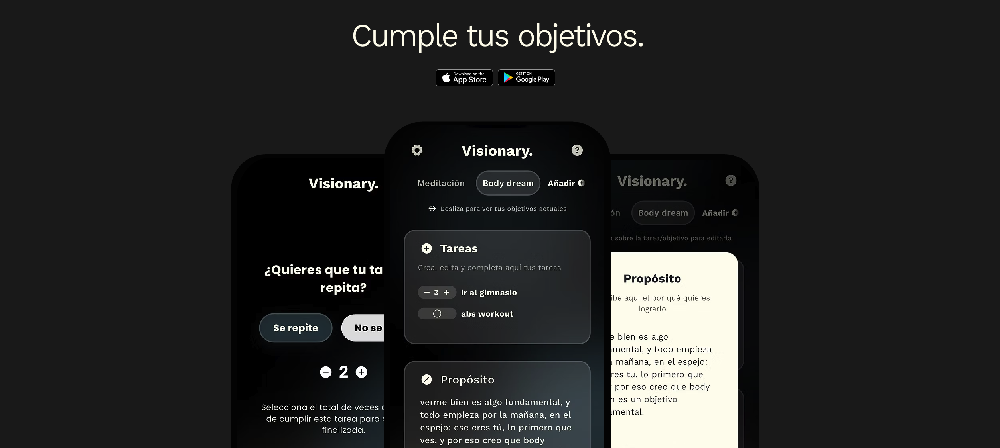

# Visionary.

### Make your ambitions measurable.

**Set meaningful goals. Build consistent habits. See how far you've come.**

A personal goal-tracking application designed to transform ambitions into actionable plans and measurable progress.

Built with Flutter & Firebase.

---

## Ambition needs direction.

Everyone has goals. Learning a new skill, improving personal habits, completing a project, or working toward something bigger.

The challenge isn't always knowing what you want to achieve. It's staying focused, maintaining consistency, and recognizing the progress you're making along the way.

**Visionary was created to bridge the gap between setting a goal and achieving it.**

A simpler, more structured way to turn long-term ambitions into everyday action.

---

## From intention to achievement.

Visionary brings goal planning, task management, and progress tracking into a single experience.

### 01. Define your goals

Turn personal ambitions into clear objectives, with priorities, descriptions, and target dates that give each goal a sense of direction.

### 02. Break them down

Big goals become manageable when divided into smaller steps. Organize your objectives into milestones and actionable tasks.

### 03. Track your progress

Follow your achievements through visual progress indicators, completion percentages, and activity history.

### 04. Keep moving forward

Maintain a clear view of what you've accomplished, what remains unfinished, and where to focus next.

---

## Less complexity. More clarity.

Productivity tools often fall into two extremes: overly simplistic checklists or complex systems that require more effort to manage than the goals themselves.

Visionary takes a different approach.

**A focused experience built around what matters: making progress.**

- **Clarity by design.** A straightforward environment for organizing objectives.
- **Progress made visible.** Understand how individual actions contribute to larger ambitions.
- **Structure without unnecessary complexity.** Plan goals and milestones in one place.
- **Your goals, across devices.** Account-based access and cloud synchronization.
- **Built around the individual.** A personal space for long-term objectives and everyday achievements.

---

## Technology that supports the experience.

Visionary combines cross-platform mobile development with cloud-based infrastructure to deliver a consistent and connected application.

**Flutter · Dart · Firebase**

The project emphasizes modular software architecture, maintainability, and a user-centered interface.

Technology is the foundation. The experience is the priority.

---

## The vision.

Visionary began with a simple idea:

**Progress should be easier to understand, not harder to manage.**

The project explores how thoughtful software design can help individuals translate intentions into concrete action.

Its long-term direction includes more meaningful progress insights, smarter reminders, and an increasingly seamless experience for managing personal objectives.

Because achieving a goal isn't a single moment.

**It's the accumulation of everything you do to get there.**

---

### VISIONARY

**Make your ambitions measurable.**

An independent project by [Mario Gabarrón](https://github.com/mariogabarron).

